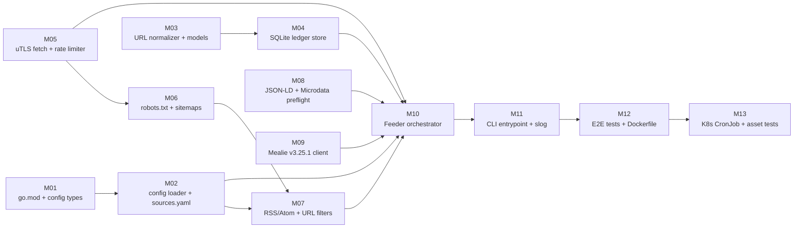

# Phase 2 Engineering Roadmap: `mealie-feeder`

> **Execution Model:** Multi-tier Advisor-Executor Pipeline (`Gemini 4` Lead Architect + `@spark-coder` / `nvidia/Qwen3.8-Flash-Next-FP4-Local` with `@flash-executor` fallback).
> **Phase 1 DGX Spark Health Baseline:** Verified at Gate 0 via `check_spark_health` (`healthy: true`, endpoint `http://happy.tail749110.ts.net:8000/v1/models`, model `nvidia/Qwen3.8-Flash-Next-FP4-Local`, latency `126.94 ms`, `failure_code: NONE`).

---

## 1. Milestone Sizing & Invariants

Each Phase 2 milestone specification under `docs/specs/M*_SPEC.md` is strictly bounded to **1-2 cohesive Go implementation files plus 1 deterministic `*_test.go` file** (with packaging/manifest extensions in M12-M13) and documents:
- Explicit **Pre-conditions** and **Post-conditions** (Design by Contract).
- Exact exported Go package names, struct/interface definitions, and function signatures.
- Deterministic offline test plans (`net/http/httptest`, mocked interfaces, `:memory:` SQLite; zero live origin network calls).
- A single verification command executed with `-race` enabled.

---

## 2. Dependency-Ordered Milestone Matrix



| Milestone | Scope Summary | Target Files | Verification Gate |
| :--- | :--- | :--- | :--- |
| [M01](docs/specs/M01_SPEC.md) | Go module definition (`1.27.4`), config structs, and invariant validation | `go.mod`, `internal/config/config.go`, `internal/config/config_test.go` | `go test -v -race -cover ./internal/config` |
| [M02](docs/specs/M02_SPEC.md) | YAML file loaders, env resolution, and 16-domain `configs/sources.yaml` (14 enabled, 2 disabled) | `internal/config/loader.go`, `configs/sources.yaml`, `internal/config/loader_test.go` | `go test -v -race -cover ./internal/config` |
| [M03](docs/specs/M03_SPEC.md) | Canonical URL normalizer, state transition rules, and ledger domain models | `internal/ledger/models.go`, `internal/ledger/normalize.go`, `internal/ledger/normalize_test.go` | `go test -v -race -cover ./internal/ledger` |
| [M04](docs/specs/M04_SPEC.md) | Pure-Go `modernc.org/sqlite` DDL, transactions, `orgURL` reconciliation, and queries | `internal/ledger/sqlite.go`, `internal/ledger/sqlite_test.go` | `go test -v -race -cover ./internal/ledger` |
| [M05](docs/specs/M05_SPEC.md) | `refraction-networking/utls` transport, browser headers, per-domain rate limiter, challenge guard | `internal/fetch/ratelimit.go`, `internal/fetch/client.go`, `internal/fetch/client_test.go` | `go test -v -race -cover ./internal/fetch` |
| [M06](docs/specs/M06_SPEC.md) | `robots.txt` parser and recursive `.xml` / `.xml.gz` sitemap engine | `internal/discover/robots.go`, `internal/discover/sitemap.go`, `internal/discover/sitemap_test.go` | `go test -v -race -cover ./internal/discover` |
| [M07](docs/specs/M07_SPEC.md) | `gofeed` RSS/Atom conditional fetcher, regex URL filter, and discovery facade | `internal/discover/filter.go`, `internal/discover/feed.go`, `internal/discover/feed_test.go` | `go test -v -race -cover ./internal/discover` |
| [M08](docs/specs/M08_SPEC.md) | `x/net/html` JSON-LD + Microdata recipe preflight and OpenGraph stub detector | `internal/preflight/jsonld.go`, `internal/preflight/preflight.go`, `internal/preflight/preflight_test.go` | `go test -v -race -cover ./internal/preflight` |
| [M09](docs/specs/M09_SPEC.md) | Typed Mealie `v3.25.1` REST client (`recipes`, `html-or-json`, `test-scrape-url`, `about`) | `internal/mealie/types.go`, `internal/mealie/client.go`, `internal/mealie/client_test.go` | `go test -v -race -cover ./internal/mealie` |
| [M10](docs/specs/M10_SPEC.md) | Orchestrator engine (`seed`, `sync`, `inspect`, `status`), budgets, and domain worker pool | `internal/feeder/report.go`, `internal/feeder/engine.go`, `internal/feeder/engine_test.go` | `go test -v -race -cover ./internal/feeder` |
| [M11](docs/specs/M11_SPEC.md) | CLI entrypoint, `flag` subcommands, `slog` logging, exit codes, and `SIGINT`/`SIGTERM` | `cmd/mealie-feeder/cli.go`, `cmd/mealie-feeder/main.go`, `cmd/mealie-feeder/cli_test.go` | `go test -v -race -cover ./cmd/mealie-feeder` |
| [M12](docs/specs/M12_SPEC.md) | Full in-process E2E integration tests (`httptest` + `:memory:` SQLite) & `distroless` `Dockerfile` | `internal/feeder/e2e_test.go`, `Dockerfile` | `CGO_ENABLED=0 go test -v -race -cover ./...` |
| [M13](docs/specs/M13_SPEC.md) | Kubernetes `CronJob` bundle (`deploy/k8s/`) and starter asset verification test | `deploy/k8s/*.yaml`, `internal/config/starter_assets_test.go` | `CGO_ENABLED=0 go test -v -race -cover ./...` |

---

## 3. Phase 2 Global Verification Gate

Before opening any Phase 2 PR, all of the following must exit `0`:

```bash
test -z "$(gofmt -l .)"
go mod tidy && go mod verify
CGO_ENABLED=0 go vet ./...
CGO_ENABLED=0 go test -v -race -cover ./...
CGO_ENABLED=0 GOOS=linux GOARCH=amd64 go build -trimpath -ldflags="-s -w" -o /tmp/mealie-feeder ./cmd/mealie-feeder
```

And after merge + image release to `ghcr.io/paulojauregui/mealie-feeder`:
1. Execute initial backfill of `seeds/greatest-hits.yaml` (`mealie-feeder seed`) against Mealie `v3.25.1` from workstation or one-off K3s `Job`.
2. Deploy `deploy/k8s/` manifests via `paulojauregui/k8s-gitops` into namespace `mealie` and observe first automated `CronJob` execution.
