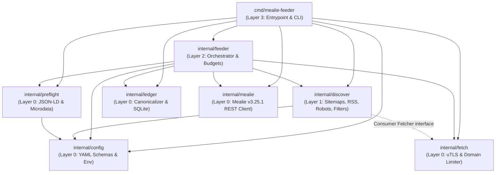
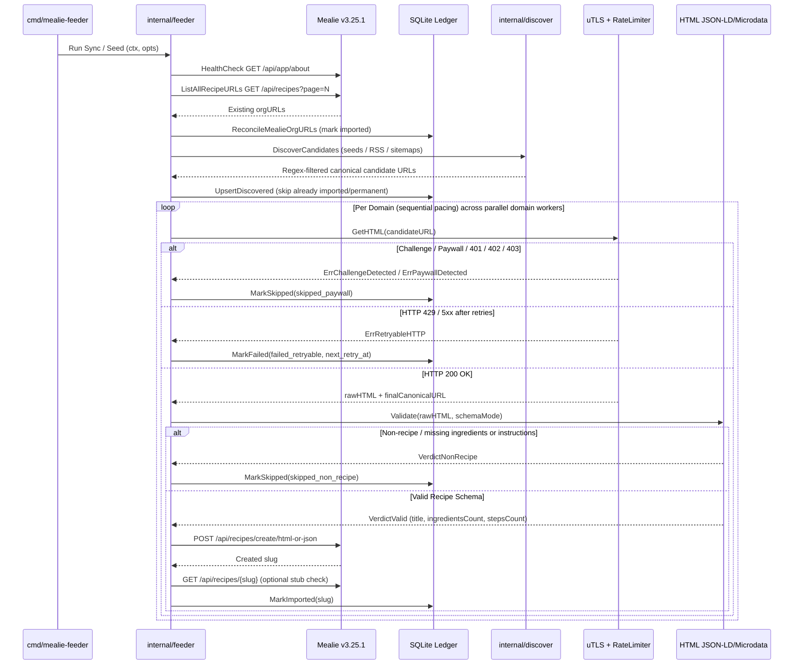
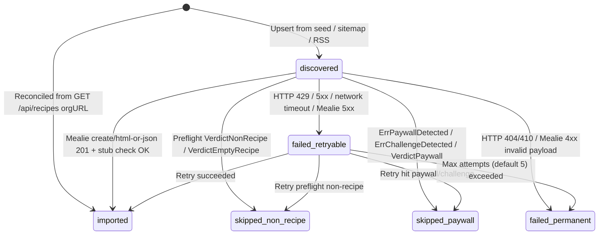

# System Architecture: `mealie-feeder`

> **Phase 1 Architecture Specification** | Target Runtime: **Go `1.27.4`** (`CGO_ENABLED=0`) | Target Container: **`gcr.io/distroless/static-debian12:nonroot`** | Target Server: **Mealie `v3.25.1`**

---

## 1. Purpose, Constraints, and Design Philosophy

`mealie-feeder` is a deterministic, stateful Go CLI and Kubernetes `CronJob` orchestrator that seeds and continuously updates a self-hosted **Mealie (`v3.25.1`)** recipe library from curated multi-cuisine seed lists, XML sitemaps, and RSS/Atom feeds.

Rather than re-implementing recipe parsing, ingredient normalization, or image processing, `mealie-feeder` acts as an intelligent, polite ingestion control plane around Mealie's existing `recipe_scrapers` pipeline. Its architecture is governed by six empirical constraints established against Mealie `v3.25.1` and live origin food sites:

1. **Single-Fetch Ingestion (`POST /api/recipes/create/html-or-json`):** Mealie's `create_from_html()` endpoint accepts pre-fetched HTML plus the canonical `url`, bypassing Mealie's internal `safe_scrape_html()` HTTP client while still executing the full `recipe_scrapers` extractor, tag/category organizer (`includeTags: true`, `includeCategories: true`), and image downloader (`finalize_scraped_recipe`). Using `create/url/bulk` is avoided because `RecipeBulkScraperService` hardcodes `include_tags=False` and `include_categories=False` and lacks per-domain rate control.
2. **Pre-Flight Schema Verification Prevents LLM Fallback & OpenGraph Stubs:** When Mealie's `recipe_scrapers` cannot extract ingredients or instructions (such as on roundups, gear reviews, or paywalled pages), Mealie falls back to `RecipeScraperOpenAI` (90-180s remote vLLM call on DGX Spark) and then `RecipeScraperOpenGraph`, persisting broken stub recipes containing `"Could not detect ingredients"`. `mealie-feeder` therefore validates Schema.org `Recipe` markup locally *before* calling Mealie.
3. **Microdata Exception & Upstream Scraper Bug Mitigation:** Live probing proved that 15 of 16 starter domains emit `<script type="application/ld+json">` (`@type: "Recipe"`), whereas `smittenkitchen.com` emits exclusively Schema.org Microdata (`itemscope itemtype="http://schema.org/Recipe"`). However, upstream check verified that neither Mealie `v3.25.1` (`recipe-scrapers==15.12.0`) nor Mealie `v3.31.0` (`recipe-scrapers==15.13.0`) cleanly ingests `smittenkitchen.com` (parses 0 steps under `RecipeScraperPackage`) or `thespruceeats.com` (`TheSpruceEats.ingredients()` uses stale selector `li.structured-ingredients__list-item p` returning `[]`, and Mealie `clean_scraper()` `try_get_default` checks `value == [""]` rather than `not value`, storing 0 ingredients). Consequently, `configs/sources.yaml` manages **14 active enabled starter domains**, keeps **2 temporarily disabled starter domains** (`smittenkitchen.com`, `thespruceeats.com` with `enabled: false`), and maintains **4 excluded domains** (`foodnetwork.com`, `food52.com`, `cooking.nytimes.com`, `americastestkitchen.com`).
4. **Canonical `orgURL` Deduplication:** Mealie enforces uniqueness only on `(slug, group_id)` and permits duplicate `orgURL` imports (`Name (1)` .. `Name (10)`). `mealie-feeder` must reconcile Mealie's existing `orgURL` inventory via paginated `GET /api/recipes` and persist canonicalized URL state in SQLite (`modernc.org/sqlite`).
5. **Browser-TLS Fingerprinting + Header Consistency:** Dotdash Meredith properties (`seriouseats.com`, `allrecipes.com`, `simplyrecipes.com`, `thespruceeats.com`) sit behind Cloudflare TLS (`JA3`/`JA4`) + HTTP header checks. Plain `net/http` receives `HTTP 403` without browser TLS and consistent desktop headers (`User-Agent`, `Accept`, `Accept-Language`, `Sec-Ch-Ua*`, `Sec-Fetch-*`), whereas `refraction-networking/utls` with Chrome/Safari profiles negotiates TLS 1.3 + HTTP/2 (`h2`) and resolves `HTTP 200 OK`.
6. **Strict Anti-Challenge & Containment Boundaries:** `mealie-feeder` never solves or bypasses CAPTCHAs, proof-of-work gates (e.g., Turnstile or hashcash JS challenges), or paywalls; encountering one fails closed cleanly. Furthermore, `agent-workshop` runs under `isolate-agent-workshop` (`CiliumNetworkPolicy` blocking cluster/RFC1918 traffic), so Phase B execution runs either from an operator workstation (`https://mealie.paulojauregui.com`) or as an in-cluster Kubernetes `CronJob` in namespace `mealie` targeting `http://mealie.mealie.svc.cluster.local:9000`.

---

## 2. Verified Go 1.27.4 Dependency Selection

All third-party dependencies were resolved against `proxy.golang.org`, compiled with `go version go1.27.4 linux/amd64` and `CGO_ENABLED=0`, and empirically benchmarked against live origin sitemaps.

### 2.1 Approved Module Matrix

| Module Path | Pinned Version | Role | `CGO_ENABLED=0` | Transitive Footprint & Rationale |
| :--- | :--- | :--- | :--- | :--- |
| `github.com/refraction-networking/utls` | `v1.8.2` | Browser TLS `ClientHello` fingerprinting (`HelloChrome_Auto`, `HelloSafari_Auto`) | Yes | Standard `net/http` `http.RoundTripper` compatibility; clean `http2.Transport.NewClientConn` integration; zero forked HTTP structs. |
| `golang.org/x/net` | `v0.62.0` | `html` tokenizer (`x/net/html`) & HTTP/2 (`x/net/http2`) | Yes | Streaming HTML tokenization for `<script type="application/ld+json">` and Microdata attributes; explicit HTTP/2 over `uTLS`. |
| `modernc.org/sqlite` | `v1.62.0` | Pure-Go SQLite 3.54.1 ledger (`database/sql` driver `"sqlite"`) | Yes | CGo-free transpiled SQLite supporting WAL mode, `busy_timeout`, `foreign_keys`, and hermetic `scratch`/`distroless` builds. |
| `gopkg.in/yaml.v3` | `v3.0.1` | Parsing `configs/sources.yaml` and `seeds/greatest-hits.yaml` | Yes | Zero external dependencies; strict struct decoding. |
| `github.com/mmcdole/gofeed` | `v1.5.0` | Universal RSS 2.0 & Atom 1.0 feed parser | Yes | Small dependency tree (`goxpp/v2 v2.0.0`, `golang.org/x/net`, `golang.org/x/text`); handles date/guid quirks across WordPress & Conde Nast feeds. |
| `golang.org/x/sync` | `v0.25.0` | Bounded cross-domain concurrency (`errgroup`) | Yes | Deterministic worker-pool cancellation and error propagation. |
| `golang.org/x/time` | `v0.16.0` | Token-bucket rate limiting (`rate.Limiter`) | Yes | Precise per-domain pacing with dynamic burst=1 enforcement. |
| Stdlib (`encoding/xml`, `compress/gzip`, `log/slog`, `flag`) | Go `1.27.4` | Sitemap XML/gzip streaming, structured logging, CLI flags | Yes | Zero external CLI/XML bloat; full control over `<sitemapindex>` recursion and gzip limits. |

### 2.2 Empirical TLS Engine Trade-Off: `refraction-networking/utls` vs. `bogdanfinn/tls-client`

Both pure-Go TLS impersonation libraries were compiled (`-ldflags="-s -w"`, `CGO_ENABLED=0`) and tested live against `https://www.seriouseats.com/sitemap_1.xml` (2.86 MB) and `https://www.allrecipes.com/sitemap_1.xml` (3.86 MB).

| Evaluation Criterion | `refraction-networking/utls` (`v1.8.2`) | `bogdanfinn/tls-client` (`v1.18.1` + `fhttp v0.7.3`) |
| :--- | :--- | :--- |
| Live Result (`seriouseats.com/sitemap_1.xml`) | `200 OK`, TLS 1.3 (`0x0304`), ALPN `h2`, cipher `0x1301` | `200 OK`, TLS 1.3 (`0x0304`), ALPN `h2`, cipher `0x1301` |
| Live Result (`allrecipes.com/sitemap_1.xml`) | `200 OK`, TLS 1.3 (`0x0304`), ALPN `h2`, cipher `0x1301` | `200 OK`, TLS 1.3 (`0x0304`), ALPN `h2`, cipher `0x1301` |
| Standard Library `net/http` Compatibility | Native (`*http.Request`, `*http.Response`, `http.RoundTripper`) | Incompatible (requires `bogdanfinn/fhttp` fork types across callers) |
| Stripped TLS-Only Binary Size | **7.4 MB** (`7,753,888` B) | **12.0 MB** (`12,054,688` B) |
| Full Production Stack Binary Size | **10.6 MB** (`10,633,376` B, incl. SQLite + `gofeed` + `yaml.v3`) | >15 MB estimated |
| **Architectural Decision** | **Selected** | Rejected (heavy fork lock-in + +55% TLS binary overhead) |

---

## 3. System Topology & Acyclic Package DAG

### 3.1 Repository Layout & Layering

```text
mealie-feeder/
├── cmd/mealie-feeder/
│   ├── main.go              # Signal context, exit codes, top-level dispatch
│   ├── cli.go               # Subcommand flagsets (seed, sync, inspect, status, version) & slog setup
│   └── cli_test.go
├── configs/
│   └── sources.yaml         # Production 16-domain starter registry (14 enabled, 2 disabled) & exclusions
├── seeds/
│   └── greatest-hits.yaml   # Live-verified multi-cuisine starter catalog
├── internal/
│   ├── config/              # Layer 0: Schemas, env resolution, YAML loading, validation
│   ├── fetch/               # Layer 0: uTLS transport, header profiles, rate limiter, challenge guard
│   ├── preflight/           # Layer 0: x/net/html JSON-LD & Microdata recipe verifier + stub detector
│   ├── ledger/              # Layer 0: URL canonicalizer, state machine, SQLite store
│   ├── mealie/              # Layer 0: Typed Mealie v3.25.1 REST client
│   ├── discover/            # Layer 1: robots.txt, recursive XML/gzip sitemaps, RSS/Atom, regex filters
│   └── feeder/              # Layer 2: Orchestrator (seed, sync, inspect, status), budgets, worker pools
├── deploy/k8s/              # Phase B Kubernetes CronJob, PVC, ConfigMap, ExternalSecret manifests
├── Dockerfile               # Multi-stage golang:1.27.4 -> distroless/static-debian12:nonroot
├── go.mod
└── go.sum
```

### 3.2 Acyclic Dependency Graph

Layer 0 foundation packages maintain a strictly acyclic dependency structure: `config` has **zero dependencies on any internal packages**, serving as the root schema contract. Sibling Layer 0 infrastructure packages (`fetch`, `ledger`, `mealie`) similarly avoid cross-dependencies, while `preflight` depends solely on `config` (`preflight -> config`) to consume typed `config.SchemaMode` definitions. All specification scopes remain minimal and cleanly compilable for autonomous execution.



### 3.3 End-to-End Ingestion Data Flow



---

## 4. Detailed Package Specifications

### 4.1 `cmd/mealie-feeder` (CLI Subcommands, Flags & Exit Codes)

Implemented with stdlib `flag` and `log/slog` for zero external CLI bloat.

| Subcommand | Purpose | Primary Flags |
| :--- | :--- | :--- |
| `seed` | Ingest curated `seeds/greatest-hits.yaml` manifest | `--seeds`, `--sources`, `--db`, `--mealie-url`, `--cuisine`, `--domain`, `--max-per-run`, `--dry-run` |
| `sync` | Incremental crawl of RSS/Atom + sitemaps (`<lastmod>` prioritized) + retry queue | `--sources`, `--db`, `--mealie-url`, `--domain`, `--max-per-run`, `--workers`, `--dry-run` |
| `inspect` | Single-URL diagnostic: fetch, preflight parse, optional Mealie `test-scrape-url` | `--url` (required), `--sources`, `--tls-mode`, `--test-scrape` |
| `status` | Reconcile optional Mealie count + print SQLite ledger counts and last runs | `--db`, `--sources`, `--mealie-url`, `--json` |
| `version` | Print build version, commit SHA, Go runtime version | None |

**Global Flags:** `--log-format` (`text` | `json`, default `text`), `--log-level` (`debug` | `info` | `warn` | `error`, default `info`), `--timeout` (run context timeout, default `25m`).

**Deterministic Exit Codes:**
- `0`: Run completed with zero fatal errors and zero unhandled retryable budget exhaustions (skipping non-recipes or existing duplicates is normal and exits `0`).
- `1`: Fatal runtime error (unreadable SQLite DB, unrecoverable I/O failure, Mealie authentication `401`/`403`, or context timeout before completion).
- `2`: CLI argument, flag, or YAML configuration schema validation error.
- `3`: Partial failure (Mealie became unreachable mid-run or failure ratio exceeded configured threshold).

### 4.2 `internal/config` (Configuration Schemas & Precedence)

Configuration precedence follows standard Twelve-Factor order: **CLI Flags > Environment Variables > YAML Defaults**.

* **Environment Variables:**
  * `MEALIE_URL` (required for `seed`/`sync`; e.g., `http://mealie.mealie.svc.cluster.local:9000`)
  * `MEALIE_API_TOKEN` (required bearer token for Mealie API; never logged or serialized)
  * `MEALIE_FEEDER_DB` (SQLite file path; default `./mealie-feeder.db`)
  * `MEALIE_FEEDER_SOURCES` (path to `sources.yaml`; default `./configs/sources.yaml`)
  * `MEALIE_FEEDER_SEEDS` (path to `greatest-hits.yaml`; default `./seeds/greatest-hits.yaml`)
* **Validation Invariants:** Reject empty domains, invalid regexes in `allow_patterns`/`deny_patterns`/`sitemap_include_patterns`, negative durations, unknown `tls_mode` (`chrome_auto`, `safari_auto`, `plain`), unknown `schema_mode` (`jsonld`, `microdata`, `auto`), or `max_per_run <= 0` when configured on an enabled source.

### 4.3 `internal/fetch` (Browser-TLS Transport, Polite Limiter & Anti-Challenge Guard)

* **`uTLS` RoundTripper:**
  * Wraps `net.Dialer` with `utls.UClient(rawConn, &utls.Config{ServerName: host}, clientHelloID)`.
  * Supported profiles: `chrome_auto` (`utls.HelloChrome_Auto`), `safari_auto` (`utls.HelloSafari_Auto`), and `plain` (standard `crypto/tls`).
  * Negotiates ALPN during `uConn.HandshakeContext(ctx)`: if `uConn.ConnectionState().NegotiatedProtocol == "h2"`, wraps the connection via `http2.Transport.NewClientConn(uConn)` (pooled per `scheme://host:port` with reconnect on closed conn); otherwise serves HTTP/1.1 over `uConn`.
  * **Header Consistency Profile:** Injects coherent desktop Chrome/Safari headers (`User-Agent`, `Accept`, `Accept-Language: en-US,en;q=0.9`, `Sec-Ch-Ua`, `Sec-Ch-Ua-Mobile: ?0`, `Sec-Ch-Ua-Platform`, `Sec-Fetch-Dest: document`, `Sec-Fetch-Mode: navigate`, `Sec-Fetch-Site: none`) so Cloudflare's TLS/HTTP fingerprint correlation passes cleanly.
* **Per-Domain Polite Rate Limiter:**
  * Maintains an independent `rate.Limiter` (`burst = 1`) and `min_interval` + jitter (`0..500ms`) per canonical domain.
  * Honors `robots.txt` `Crawl-delay` as a strict lower bound (`effectiveInterval = max(config.MinInterval, robots.CrawlDelay)`).
  * Processes multiple domains concurrently, but enforces **strictly sequential (concurrency=1) access per individual domain** to avoid triggering rate limits on origin food blogs.
* **Retry & Zero-Bypass Policy:**
  * `429 Too Many Requests`: honors `Retry-After` header (seconds or HTTP-date, capped at 120s) up to `max_retries` (default 2).
  * `500`, `502`, `503`, `504`: bounded exponential backoff with jitter.
  * **Fail-Closed Challenge/Paywall Detection:** If response headers contain `cf-mitigated: challenge` or body markers indicate Cloudflare Turnstile (`challenges.cloudflare.com`), `HASHCASH_CONFIG`, HTTP `402 Payment Required`, or `403 Forbidden` with challenge markers, `internal/fetch` immediately returns `ErrChallengeDetected` or `ErrPaywallDetected` without retries or bypass attempts.

### 4.4 `internal/discover` (`robots.txt`, Recursive Sitemaps & RSS/Atom)

1. **`robots.txt` Compliance:**
   * Fetches `/robots.txt` once per domain per run (cached in memory).
   * Parses `User-agent: *` rules (`Disallow:`, `Allow:`, `Crawl-delay:`) and extracts `Sitemap:` lines.
   * **Malformed Sitemap Guard:** Validates extracted `Sitemap:` URLs via `url.Parse` (`scheme == http/https`, non-empty `Host`), discarding upstream bugs such as `smittenkitchen.com`'s literal `Sitemap: http:///sitemap.xml` and falling back to configured `sitemap_urls`.
2. **Recursive XML & `.xml.gz` Sitemaps:**
   * Transparently decompresses `Content-Encoding: gzip` or `.xml.gz` responses via `compress/gzip` (capped at 64 MiB decompressed to prevent zip bombs).
   * Handles `<sitemapindex>` recursion (depth limit = 3, visited-URL cycle set).
   * Applies `sitemap_include_patterns` *before* fetching child sitemaps (critical for `bbcgoodfood.com`, selecting only the 153 `YYYY-QN-recipe.xml` files out of 268 child sitemaps, and `kingarthurbaking.com` where recipes reside exclusively on `page=2` and `page=3`).
   * Collects `<url><loc>` and `<lastmod>`, sorting candidates descending by `<lastmod>` (missing `<lastmod>` treated as zero-time fallback) so newest recipes are discovered first.
3. **RSS 2.0 / Atom 1.0 Discovery:**
   * Uses `github.com/mmcdole/gofeed v1.5.0` on configured `rss_urls` (active on 12 of 16 starter domains; disabled for the 4 Dotdash Meredith properties whose feeds return 404 or Google News sitemaps).
   * Tracks `feed_cursors` (`etag`, `last_modified`, `last_item_published_at`) in SQLite to short-circuit unchanged feeds via conditional `If-None-Match` / `If-Modified-Since`.
4. **Regex URL Filtering:**
   * Evaluation order per candidate URL: `robots.Allowed(path)` -> `!MatchesAny(deny_patterns)` -> `MatchesAny(allow_patterns)`.

### 4.5 `internal/preflight` (HTML Tokenization, JSON-LD / Microdata & Stub Guard)

Uses `golang.org/x/net/html.NewTokenizer` exclusively (zero regexes over HTML):

1. **JSON-LD Extraction (`<script type="application/ld+json">`):**
   * Collects all JSON-LD script blocks (case-insensitive media type match, stripping `;charset=...` parameters).
   * Recursively walks JSON values to find Recipe nodes across three structures:
     1. Top-level JSON object (`{"@type": "Recipe", ...}`)
     2. Top-level JSON array (`[{"@type": "Recipe", ...}]`)
     3. `@graph` array (`{"@graph": [{"@type": "WebPage"}, {"@type": ["Recipe", ...]}]}`)
   * `@type` matching accepts either string `"Recipe"` or JSON array containing `"Recipe"` (case-insensitive on `"https://schema.org/Recipe"` / `"Recipe"`).
   * Verifies `recipeIngredient` resolves to at least 1 non-empty string AND `recipeInstructions` resolves to at least 1 non-empty step (handling `string`, `[]string`, `HowToStep.text`, and `HowToSection.itemListElement`).
   * Unescapes HTML entities (`html.UnescapeString`) on `name` and `recipeCategory`.
2. **Schema.org Microdata Extraction (for `smittenkitchen.com` / `schema_mode: microdata|auto`):**
   * Scans HTML element attributes for `itemtype` matching `^https?://schema\.org/Recipe$` (space-separated tokens) and verifies presence of at least one `itemprop="recipeIngredient"` (or `itemprop="ingredients"`) and `itemprop="recipeInstructions"`.
3. **Verdict Matrix:**
   * `VerdictValid`: Sufficient recipe schema found; eligible for Mealie `create/html-or-json`.
   * `VerdictNonRecipe`: Roundup, gear review, or blog post lacking valid `Recipe` schema (`skipped_non_recipe`).
   * `VerdictEmptyRecipe`: Schema header exists, but ingredients or instructions are empty (`skipped_non_recipe`).
   * `VerdictPaywall`: Paywall DOM indicator detected alongside missing/truncated schema (`skipped_paywall`).
4. **Post-Ingest Incomplete & OpenGraph Stub Guard:**
   * Helper `IsOpenGraphStub(ingredients []string, instructions []string, description string) bool` checks Mealie's returned recipe if post-ingest verification is enabled. It returns `true` if `description` contains `"could not detect ingredients"` (case-insensitive) OR `len(ingredients) == 0 || len(instructions) == 0`, catching half-broken `recipe_scrapers` adapters with 0 ingredients OR 0 steps cleanly (e.g., TheSpruceEats 0 ingredients bug or SmittenKitchen 0 steps bug) as well as OpenGraph fallback stubs.

### 4.6 `internal/ledger` (Canonicalizer, State Machine & SQLite DDL)

#### Canonical URL Normalizer (`NormalizeURL`)
Given a raw URL string:
1. Parse via `url.Parse`; enforce `http` or `https` scheme; normalize scheme and hostname to lowercase; strip default ports (`:80`, `:443`).
2. Clear URL fragment (`#...`).
3. Remove tracking query parameters (`utm_*`, `fbclid`, `gclid`, `dclid`, `msclkid`, `mc_cid`, `mc_eid`, `igshid`, `ref`, `ref_src`, `_hsenc`, `_hsmi`, `mkt_tok`, `yclid`). Sort remaining query parameters lexicographically by key (preserving multi-values).
4. Normalize clean path (`path.Clean` preserving trailing slash presence consistently or using host-normalized path; retain exact canonical trailing slash returned by HTTP redirects / `<link rel="canonical">` when known, while indexing a trailing-slash-insensitive lookup key if needed for `orgURL` deduplication).

#### State Machine



#### SQLite Schema DDL (`modernc.org/sqlite`)

Connection DSN pragmas: `?_pragma=journal_mode(WAL)&_pragma=busy_timeout(5000)&_pragma=foreign_keys(ON)`.

```sql
CREATE TABLE IF NOT EXISTS recipes_ledger (
    id                INTEGER PRIMARY KEY AUTOINCREMENT,
    canonical_url     TEXT NOT NULL UNIQUE,
    source_url        TEXT NOT NULL,
    domain            TEXT NOT NULL,
    discovery_source  TEXT NOT NULL, -- 'seed', 'sitemap', 'rss', 'mealie_sync'
    cuisine           TEXT NOT NULL DEFAULT '',
    title             TEXT NOT NULL DEFAULT '',
    state             TEXT NOT NULL CHECK (state IN (
        'discovered',
        'imported',
        'skipped_non_recipe',
        'skipped_paywall',
        'failed_retryable',
        'failed_permanent'
    )),
    mealie_slug       TEXT NOT NULL DEFAULT '',
    http_status       INTEGER NOT NULL DEFAULT 0,
    attempts          INTEGER NOT NULL DEFAULT 0,
    last_error        TEXT NOT NULL DEFAULT '',
    next_retry_at     TEXT NOT NULL DEFAULT '', -- RFC3339 UTC
    discovered_at     TEXT NOT NULL,            -- RFC3339 UTC
    updated_at        TEXT NOT NULL             -- RFC3339 UTC
);

CREATE INDEX IF NOT EXISTS idx_ledger_state_retry
    ON recipes_ledger(state, next_retry_at);
CREATE INDEX IF NOT EXISTS idx_ledger_domain_state
    ON recipes_ledger(domain, state);

CREATE TABLE IF NOT EXISTS feed_cursors (
    feed_url               TEXT PRIMARY KEY,
    domain                 TEXT NOT NULL,
    etag                   TEXT NOT NULL DEFAULT '',
    last_modified          TEXT NOT NULL DEFAULT '',
    last_item_published_at TEXT NOT NULL DEFAULT '', -- RFC3339 UTC
    last_checked_at        TEXT NOT NULL             -- RFC3339 UTC
);

CREATE TABLE IF NOT EXISTS runs (
    run_id            TEXT PRIMARY KEY,
    command           TEXT NOT NULL, -- 'seed' | 'sync'
    started_at        TEXT NOT NULL, -- RFC3339 UTC
    finished_at       TEXT NOT NULL DEFAULT '',
    status            TEXT NOT NULL, -- 'running' | 'success' | 'partial' | 'failed'
    discovered_count  INTEGER NOT NULL DEFAULT 0,
    imported_count    INTEGER NOT NULL DEFAULT 0,
    skipped_count     INTEGER NOT NULL DEFAULT 0,
    failed_count      INTEGER NOT NULL DEFAULT 0,
    dry_run           INTEGER NOT NULL DEFAULT 0,
    error_summary     TEXT NOT NULL DEFAULT ''
);
```

### 4.7 `internal/mealie` (Mealie `v3.25.1` Typed REST Client)

Uses standard `net/http.Client` (no TLS fingerprint spoofing needed for internal `http://mealie.mealie.svc.cluster.local:9000` or operator HTTPS ingress), authenticating with `Authorization: Bearer <MEALIE_API_TOKEN>`.

| Operation | HTTP Method & Path | Request Payload / Params | Response Handling |
| :--- | :--- | :--- | :--- |
| Health / Version Check | `GET /api/app/about` | None | `200 OK` -> `{ "version": "v3.25.1", ... }` |
| Sync Existing `orgURL`s | `GET /api/recipes` | `?page=1&perPage=100` (paginate until `page >= total_pages`) | `{ "items": [{ "id", "slug", "name", "orgURL" }], "page", "per_page", "total", "total_pages" }` |
| Primary Single-Fetch Ingest | `POST /api/recipes/create/html-or-json` | `{"data":"<html>...","url":"https://...","includeTags":true,"includeCategories":true}` | `201 Created` -> JSON string `"recipe-slug"` (409/422 mapped to typed API error) |
| Diagnostic / Opt-in Scrape | `POST /api/recipes/test-scrape-url` | `{"url":"https://...","useOpenai":false}` | `200 OK` -> parsed recipe JSON preview |
| Opt-in URL Scrape Fallback | `POST /api/recipes/create/url` | `{"url":"https://...","includeTags":true,"includeCategories":true}` | `201 Created` -> JSON string `"recipe-slug"` (disabled by default) |
| Post-Ingest Stub Verification | `GET /api/recipes/{slug}` | Path `{slug}` | Inspects `recipeIngredient`, `recipeInstructions`, `description` for OpenGraph stub strings |
| Optional Stub Cleanup | `DELETE /api/recipes/{slug}` | Path `{slug}` (only if `purge_stubs: true`) | `200 OK` / `204 No Content` |

### 4.8 `internal/feeder` (Orchestrator Engine & Budgets)

* **Run Budgets:** Supports global `--max-per-run` (default e.g. `100` for `sync`, unlimited or configured for `seed`) and per-source `max_per_run` caps so no single blog dominates a scheduled run.
* **Domain-Partitioned Worker Pool:** Groups pending candidates by `domain`. An `errgroup` (bounded by `--workers`, default `4`) assigns one domain queue per worker goroutine; each domain queue executes strictly serially under its `internal/fetch.DomainLimiter`.
* **Dry-Run Mode:** Executes `GET /api/recipes` reconciliation, discovery, and optionally preflight checks without writing `POST /api/recipes/create/html-or-json` or mutating `imported` state in SQLite.

---

## 5. Starter Source Registry (`configs/sources.yaml` Blueprint)

The following complete `configs/sources.yaml` blueprint encodes all **16 empirically verified starter domains** (14 active enabled starter domains, 2 temporarily disabled starter domains: `smittenkitchen.com`, `thespruceeats.com`) and the **4 explicit exclusions** (`foodnetwork.com`, `food52.com`, `cooking.nytimes.com`, `americastestkitchen.com`). Every `sitemap_urls`, `rss_urls`, `allow_patterns`, `deny_patterns`, and `schema_mode` value below was validated live against origin endpoints during Phase 1 reconnaissance.

```yaml
version: 1

defaults:
  tls_mode: chrome_auto
  schema_mode: jsonld
  min_interval: 2s
  timeout: 20s
  max_retries: 2
  max_per_run: 25
  allow_url_fallback: false

excluded_domains:
  - domain: foodnetwork.com
    reason: "Akamai Bot Manager returns HTTP 403 on plain requests; excluded from automated crawling."
  - domain: food52.com
    reason: "Aggressive rate mitigation returns HTTP 429; excluded from automated crawling."
  - domain: cooking.nytimes.com
    reason: "Subscriber paywall gates recipe bodies behind authenticated sessions."
  - domain: americastestkitchen.com
    reason: "Subscriber paywall gates full recipe catalog behind login wrappers."

sources:
  # --- Group A: WordPress / Yoast Sitemaps + Active RSS ---
  - domain: recipetineats.com
    canonical_host: www.recipetineats.com
    enabled: true
    tier: wordpress_yoast
    tls_mode: chrome_auto
    schema_mode: jsonld
    min_interval: 2s
    max_per_run: 25
    sitemap_urls:
      - https://www.recipetineats.com/sitemap_index.xml
    sitemap_include_patterns:
      - 'post-sitemap\d*\.xml$'
    rss_urls:
      - https://www.recipetineats.com/feed/
    allow_patterns:
      - '^https?://(?:www\.)?recipetineats\.com/[a-z0-9-]+/?$'
    deny_patterns:
      - '^https?://(?:www\.)?recipetineats\.com/(?:category|tag|author|about|contact|shop|collections?|page|blog)/'

  - domain: budgetbytes.com
    canonical_host: www.budgetbytes.com
    enabled: true
    tier: wordpress_yoast
    tls_mode: chrome_auto
    schema_mode: jsonld
    min_interval: 2s
    max_per_run: 25
    sitemap_urls:
      - https://www.budgetbytes.com/sitemap_index.xml
    sitemap_include_patterns:
      - 'post-sitemap\d*\.xml$'
    rss_urls:
      - https://www.budgetbytes.com/feed/
    allow_patterns:
      - '^https?://(?:www\.)?budgetbytes\.com/[a-z0-9-]+/?$'
    deny_patterns:
      - '^https?://(?:www\.)?budgetbytes\.com/(?:category|tag|author|about|contact|shop|page|meal-plans?|kitchen-basics)/'

  - domain: sallysbakingaddiction.com
    canonical_host: sallysbakingaddiction.com
    enabled: true
    tier: wordpress_yoast
    tls_mode: chrome_auto
    schema_mode: jsonld
    min_interval: 2s
    max_per_run: 25
    sitemap_urls:
      - https://sallysbakingaddiction.com/sitemap_index.xml
    sitemap_include_patterns:
      - 'post-sitemap\d*\.xml$'
    rss_urls:
      - https://sallysbakingaddiction.com/feed/
    allow_patterns:
      - '^https?://(?:www\.)?sallysbakingaddiction\.com/[a-z0-9-]+/?$'
    deny_patterns:
      - '^https?://(?:www\.)?sallysbakingaddiction\.com/(?:category|tag|author|about|contact|shop|page|baking-basics|recent-posts)/'

  - domain: onceuponachef.com
    canonical_host: www.onceuponachef.com
    enabled: true
    tier: wordpress_yoast
    tls_mode: chrome_auto
    schema_mode: jsonld
    min_interval: 2s
    max_per_run: 25
    sitemap_urls:
      - https://www.onceuponachef.com/sitemap_index.xml
    sitemap_include_patterns:
      - 'post-sitemap\d*\.xml$'
    rss_urls:
      - https://www.onceuponachef.com/feed/
    allow_patterns:
      - '^https?://(?:www\.)?onceuponachef\.com/recipes/[a-z0-9-]+\.html$'
    deny_patterns:
      - '^https?://(?:www\.)?onceuponachef\.com/(?:category|tag|author|about|contact|shop|page|inspiration)/'

  - domain: minimalistbaker.com
    canonical_host: minimalistbaker.com
    enabled: true
    tier: wordpress_yoast
    tls_mode: chrome_auto
    schema_mode: jsonld
    min_interval: 2s
    max_per_run: 25
    sitemap_urls:
      - https://minimalistbaker.com/sitemap_index.xml
    sitemap_include_patterns:
      - 'post-sitemap\d*\.xml$'
    rss_urls:
      - https://minimalistbaker.com/feed/
    allow_patterns:
      - '^https?://(?:www\.)?minimalistbaker\.com/[a-z0-9-]+/?$'
    deny_patterns:
      - '^https?://(?:www\.)?minimalistbaker\.com/(?:recipe-index|category|tag|author|about|contact|shop|page|r|ecourse|university)/'

  - domain: cookieandkate.com
    canonical_host: cookieandkate.com
    enabled: true
    tier: wordpress_yoast
    tls_mode: chrome_auto
    schema_mode: jsonld
    min_interval: 2s
    max_per_run: 25
    sitemap_urls:
      - https://cookieandkate.com/sitemap_index.xml
    sitemap_include_patterns:
      - 'post-sitemap\d*\.xml$'
    rss_urls:
      - https://cookieandkate.com/feed/
    allow_patterns:
      - '^https?://(?:www\.)?cookieandkate\.com/[a-z0-9-]+/?$'
    deny_patterns:
      - '^https?://(?:www\.)?cookieandkate\.com/(?:category|tag|author|about|contact|shop|page|monthly-seasonal-produce-guides)/'

  - domain: smittenkitchen.com
    canonical_host: smittenkitchen.com
    enabled: false
    tier: wordpress_microdata
    tls_mode: chrome_auto
    schema_mode: microdata
    min_interval: 4s
    max_per_run: 10
    sitemap_urls:
      - https://smittenkitchen.com/sitemap.xml
    rss_urls:
      - https://smittenkitchen.com/feed/
    allow_patterns:
      - '^https?://(?:www\.)?smittenkitchen\.com/\d{4}/\d{2}/[a-z0-9-]+/?$'
    deny_patterns:
      - '^https?://(?:www\.)?smittenkitchen\.com/(?:category|tag|author|about|contact|recipes|events|page)/'
    notes: "Disabled by default: upstream recipe-scrapers 15.12.0/15.13.0 under Mealie v3.25.1-v3.31.0 RecipeScraperPackage parses 0 instructions/steps from Schema.org Microdata. Uses Schema.org Microdata (not JSON-LD); robots.txt has malformed http:///sitemap.xml so explicit sitemap_urls takes precedence; conservative 4s interval avoids Cloudflare hashcash mitigation."

  - domain: loveandlemons.com
    canonical_host: www.loveandlemons.com
    enabled: true
    tier: wordpress_yoast
    tls_mode: chrome_auto
    schema_mode: jsonld
    min_interval: 2s
    max_per_run: 25
    sitemap_urls:
      - https://www.loveandlemons.com/sitemap.xml
    sitemap_include_patterns:
      - 'post-sitemap\d*\.xml$'
    rss_urls:
      - https://www.loveandlemons.com/feed/
    allow_patterns:
      - '^https?://(?:www\.)?loveandlemons\.com/[a-z0-9-]+/?$'
    deny_patterns:
      - '^https?://(?:www\.)?loveandlemons\.com/(?:category|tag|author|about|contact|shop|page|meal-plan)/'

  # --- Group B: Publisher Path-Filtered Sitemaps ---
  - domain: bonappetit.com
    canonical_host: www.bonappetit.com
    enabled: true
    tier: publisher_path_filtered
    tls_mode: chrome_auto
    schema_mode: jsonld
    min_interval: 2500ms
    max_per_run: 20
    sitemap_urls:
      - https://www.bonappetit.com/sitemap.xml
    sitemap_include_patterns:
      - 'sitemap-\d{4}-\d{2}\.xml$'
    rss_urls:
      - https://www.bonappetit.com/feed/rss
    allow_patterns:
      - '^https?://(?:www\.)?bonappetit\.com/recipe/[a-z0-9-]+$'
    deny_patterns:
      - '^https?://(?:www\.)?bonappetit\.com/(?:story|gallery|shopping|video|contributor|tag)/'

  - domain: epicurious.com
    canonical_host: www.epicurious.com
    enabled: true
    tier: publisher_path_filtered
    tls_mode: chrome_auto
    schema_mode: jsonld
    min_interval: 2500ms
    max_per_run: 20
    sitemap_urls:
      - https://www.epicurious.com/sitemap.xml
    sitemap_include_patterns:
      - 'sitemap-\d{4}-\d{2}\.xml$'
    rss_urls:
      - https://www.epicurious.com/feed/rss
    allow_patterns:
      - '^https?://(?:www\.)?epicurious\.com/recipes/food/views/[a-z0-9-]+$'
      - '^https?://(?:www\.)?epicurious\.com/recipe/[a-z0-9-]+$'
    deny_patterns:
      - '^https?://(?:www\.)?epicurious\.com/(?:story|gallery|shopping|expert-advice|video|contributor|tag)/'

  - domain: kingarthurbaking.com
    canonical_host: www.kingarthurbaking.com
    enabled: true
    tier: publisher_path_filtered
    tls_mode: chrome_auto
    schema_mode: jsonld
    min_interval: 2s
    max_per_run: 25
    sitemap_urls:
      - https://www.kingarthurbaking.com/sitemap.xml
    sitemap_include_patterns:
      - 'sitemap\.xml\?page=[23]$'
    rss_urls:
      - https://www.kingarthurbaking.com/rss.xml
    allow_patterns:
      - '^https?://(?:www\.)?kingarthurbaking\.com/recipes/[a-z0-9-]+-recipe$'
    deny_patterns:
      - '^https?://(?:www\.)?kingarthurbaking\.com/(?:recipes/collections|recipes/resources|blog|videos|author|learn)/'

  - domain: bbcgoodfood.com
    canonical_host: www.bbcgoodfood.com
    enabled: true
    tier: publisher_path_filtered
    tls_mode: chrome_auto
    schema_mode: jsonld
    min_interval: 2500ms
    max_per_run: 25
    sitemap_urls:
      - https://www.bbcgoodfood.com/sitemap.xml
    sitemap_include_patterns:
      - '\d{4}-Q[1-4]-recipe\.xml$'
    rss_urls:
      - https://www.bbcgoodfood.com/feed/
    allow_patterns:
      - '^https?://(?:www\.)?bbcgoodfood\.com/recipes/[a-z0-9-]+$'
    deny_patterns:
      - '^https?://(?:www\.)?bbcgoodfood\.com/(?:premium|review|howto|collection|glossary|user)/'

  # --- Group C: Dotdash Meredith (Cloudflare uTLS + Sitemap Only) ---
  - domain: seriouseats.com
    canonical_host: www.seriouseats.com
    enabled: true
    tier: dotdash_meredith
    tls_mode: chrome_auto
    schema_mode: jsonld
    min_interval: 3s
    max_per_run: 25
    sitemap_urls:
      - https://www.seriouseats.com/sitemap.xml
    sitemap_include_patterns:
      - 'sitemap_\d+\.xml$'
    rss_urls: []
    allow_patterns:
      - '^https?://(?:www\.)?seriouseats\.com/[a-z0-9-]+-recipe-\d+$'
      - '^https?://(?:www\.)?seriouseats\.com/[a-z0-9-]+-recipe$'
    deny_patterns:
      - '^https?://(?:www\.)?seriouseats\.com/.*-recipes-\d+$'
      - '^https?://(?:www\.)?seriouseats\.com/(?:roundups?|equipment|reviews?|techniques?|best-.*|how-to-.*|editors-favorite-.*)'

  - domain: allrecipes.com
    canonical_host: www.allrecipes.com
    enabled: true
    tier: dotdash_meredith
    tls_mode: chrome_auto
    schema_mode: jsonld
    min_interval: 3s
    max_per_run: 25
    sitemap_urls:
      - https://www.allrecipes.com/sitemap.xml
    sitemap_include_patterns:
      - 'sitemap_\d+\.xml$'
    rss_urls: []
    allow_patterns:
      - '^https?://(?:www\.)?allrecipes\.com/[a-z0-9-]+-recipe-\d+$'
      - '^https?://(?:www\.)?allrecipes\.com/recipe/\d+/[a-z0-9-]+/?$'
    deny_patterns:
      - '^https?://(?:www\.)?allrecipes\.com/(?:gallery|article|cook)/'
      - '^https?://(?:www\.)?allrecipes\.com/.*-recipes-\d+$'

  - domain: simplyrecipes.com
    canonical_host: www.simplyrecipes.com
    enabled: true
    tier: dotdash_meredith
    tls_mode: chrome_auto
    schema_mode: jsonld
    min_interval: 3s
    max_per_run: 25
    sitemap_urls:
      - https://www.simplyrecipes.com/sitemap.xml
    sitemap_include_patterns:
      - 'sitemap_\d+\.xml$'
    rss_urls: []
    allow_patterns:
      - '^https?://(?:www\.)?simplyrecipes\.com/[a-z0-9-]+-recipe-\d+$'
      - '^https?://(?:www\.)?simplyrecipes\.com/recipes/[a-z0-9-]+/?$'
    deny_patterns:
      - '^https?://(?:www\.)?simplyrecipes\.com/.*-(?:review|recipes)-\d+$'
      - '^https?://(?:www\.)?simplyrecipes\.com/(?:about-us|author)/'

  - domain: thespruceeats.com
    canonical_host: www.thespruceeats.com
    enabled: false
    tier: dotdash_meredith
    tls_mode: chrome_auto
    schema_mode: jsonld
    min_interval: 3s
    max_per_run: 25
    sitemap_urls:
      - https://www.thespruceeats.com/sitemap.xml
    sitemap_include_patterns:
      - 'sitemap_\d+\.xml$'
    rss_urls: []
    allow_patterns:
      - '^https?://(?:www\.)?thespruceeats\.com/[a-z0-9-]+-recipe-\d+$'
      - '^https?://(?:www\.)?thespruceeats\.com/recipe-for-[a-z0-9-]+-\d+$'
    deny_patterns:
      - '^https?://(?:www\.)?thespruceeats\.com/.*-recipes-\d+$'
      - '^https?://(?:www\.)?thespruceeats\.com/(?:best-.*|about-us/|author/)'
    notes: "Disabled by default: upstream recipe-scrapers 15.12.0/15.13.0 TheSpruceEats.ingredients() relies on stale selector li.structured-ingredients__list-item p returning empty [] and Mealie clean_scraper() try_get_default checks value == [''] rather than not value, ingesting 0 ingredients under Mealie v3.25.1-v3.31.0."
```

---

## 6. Deployment & Operations Blueprint (Phase B Target)

### 6.1 Dual Execution Topology (Operator CLI Backfill vs. In-Cluster `CronJob`)

Because `agent-workshop` executes inside `isolate-agent-workshop` (`CiliumNetworkPolicy` denying RFC1918 and cluster endpoints like `mealie.mealie.svc.cluster.local:9000`), runtime operations are decoupled into two secure paths:

1. **Initial Backfill (Operator Workstation CLI or One-Off Cluster `Job`):**
   ```bash
   export MEALIE_URL="https://mealie.paulojauregui.com"
   export MEALIE_API_TOKEN="<operator-api-token>"
   mealie-feeder seed \
     --seeds ./seeds/greatest-hits.yaml \
     --sources ./configs/sources.yaml \
     --db ./mealie-feeder.db
   ```
   Or trigger an initial K3s `Job` from the `mealie-feeder` `CronJob` template inside namespace `mealie` so `state.db` is populated directly on the `openebs-hostpath` PVC.
2. **Continuous Automated Sync (Kubernetes `CronJob` in Namespace `mealie`):**
   * Targets internal ClusterIP service `http://mealie.mealie.svc.cluster.local:9000` (configured in `k8s-gitops/apps/base/mealie/05-service.yaml`), bypassing external Gateway hairpinning and ingress TLS termination.
   * Schedule: Every 6 hours (`0 */6 * * *`), `concurrencyPolicy: Forbid` (mandatory so concurrent pods never contend on the `ReadWriteOnce` PVC or SQLite write lock), `activeDeadlineSeconds: 1800`.

### 6.2 Kubernetes Manifest Blueprint (`deploy/k8s/` & `k8s-gitops`)

* **Container Spec (`Dockerfile`):**
  * Stage 1: `golang:1.27.4-bookworm` building `CGO_ENABLED=0 GOOS=linux GOARCH=amd64 go build -trimpath -ldflags="-s -w" -o /out/mealie-feeder ./cmd/mealie-feeder`.
  * Stage 2: `gcr.io/distroless/static-debian12:nonroot`, copying binary, `configs/sources.yaml`, and `seeds/greatest-hits.yaml`. Runs as `USER 10001:10001` (~12-14 MB total compressed image).
* **Secrets Management (Doppler + External Secrets Operator):**
  * Matches existing `k8s-gitops/apps/base/mealie/01-external-secret.yaml`:
    * `ClusterSecretStore`: `doppler-backend` (Doppler project `k8s-eso`, config `dev`).
    * `ExternalSecret`: `mealie-feeder-secret` in namespace `mealie` syncing `MEALIE_API_TOKEN`.
* **Persistent State (`openebs-hostpath`):**
  * `PersistentVolumeClaim`: `mealie-feeder-state` (`ReadWriteOnce`, `storageClassName: openebs-hostpath`, `1Gi`) mounted at `/var/lib/mealie-feeder` (`MEALIE_FEEDER_DB=/var/lib/mealie-feeder/state.db`).
  * `emptyDir` mounted at `/tmp` so `readOnlyRootFilesystem: true` holds cleanly.
* **Pod & Container Security Context:**
  * Pod: `runAsNonRoot: true`, `runAsUser: 10001`, `runAsGroup: 10001`, `fsGroup: 10001`, `seccompProfile: { type: RuntimeDefault }`.
  * Container: `allowPrivilegeEscalation: false`, `readOnlyRootFilesystem: true`, `capabilities: { drop: ["ALL"] }`.

### 6.3 Mealie Storage & Database Scaling Considerations (`k8s-gitops`)

In `k8s-gitops/apps/base/mealie/`, Mealie currently provisions:
* `mealie-data-pvc` (`02-pvc.yaml`): `10Gi` `openebs-hostpath` mounted at `/app/data` (storing downloaded hero images, WebP thumbnails, and custom assets).
* `mealie-db` (`03-postgres-cluster.yaml`): CloudNativePG 1-instance PostgreSQL cluster with `5Gi` `openebs-hostpath`.

**Empirical Capacity Projection:**
* Each imported recipe averages ~300 KB - 1.2 MB of original + resized image assets under `/app/data/recipes/<id>/images/` and ~15 - 30 KB of PostgreSQL row + index data (ingredients, foods, units, tags, categories, instructions).
* **Phase B Initial Greatest Hits (~350 recipes):** ~350 MB of `/app/data` media + < 20 MB Postgres -> consumes < 5% of current allocations.
* **Scaled Catalog (5,000 - 15,000 recipes):** ~5 - 15 GB of `/app/data` images + ~200 - 500 MB Postgres WAL/indexes. Before scaling `sync` past ~4,000 recipes, expand `mealie-data-pvc` (`10Gi` -> `50Gi`) and `mealie-db` storage (`5Gi` -> `20Gi`) in `k8s-gitops` (note: OpenEBS LocalPV hostpath expansion or backup/restore migration since `openebs-hostpath` lacks online CSI volume resize unless recreated/migrated via CNPG backup & SeaweedFS/rsync).

---

## 7. Operational Runbooks & Observability

1. **Structured Logging (`slog` JSON):** Every run emits `run_id`, `command`, `domain`, `url`, `preflight_verdict`, `http_status`, `mealie_slug`, and `duration_ms` fields for clean Loki/Grafana ingestion on K3s.
2. **Resumable Failure Recovery:** Transient origin failures (`429`, `5xx`, TCP timeout) transition to `failed_retryable` with exponential `next_retry_at` (`1h`, `6h`, `24h`, `72h`), permanently retiring to `failed_permanent` after 5 failed attempts so broken upstream URLs do not loop indefinitely.
3. **Graceful Cancellation:** On `SIGTERM` (Kubernetes `activeDeadlineSeconds` or manual stop), the engine cancels in-flight HTTP requests, commits completed ledger updates, and marks the `runs` row with final counts before exiting.
